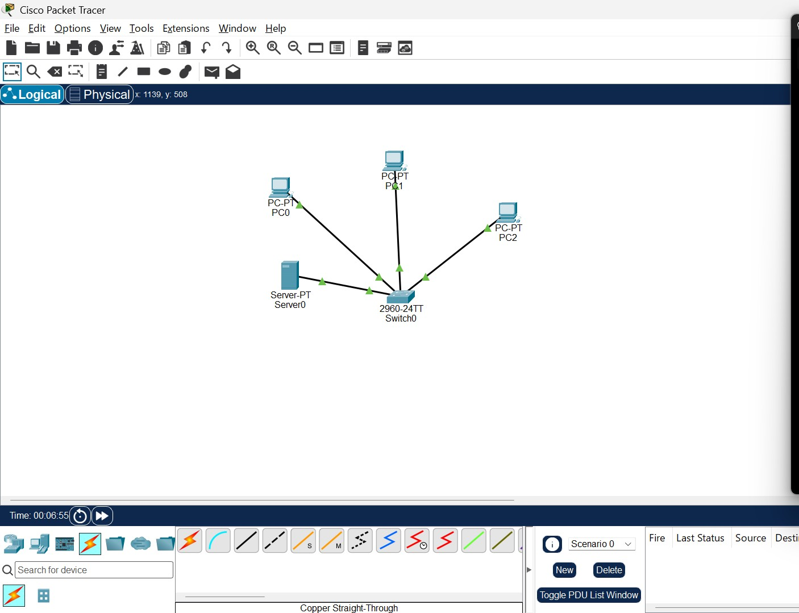
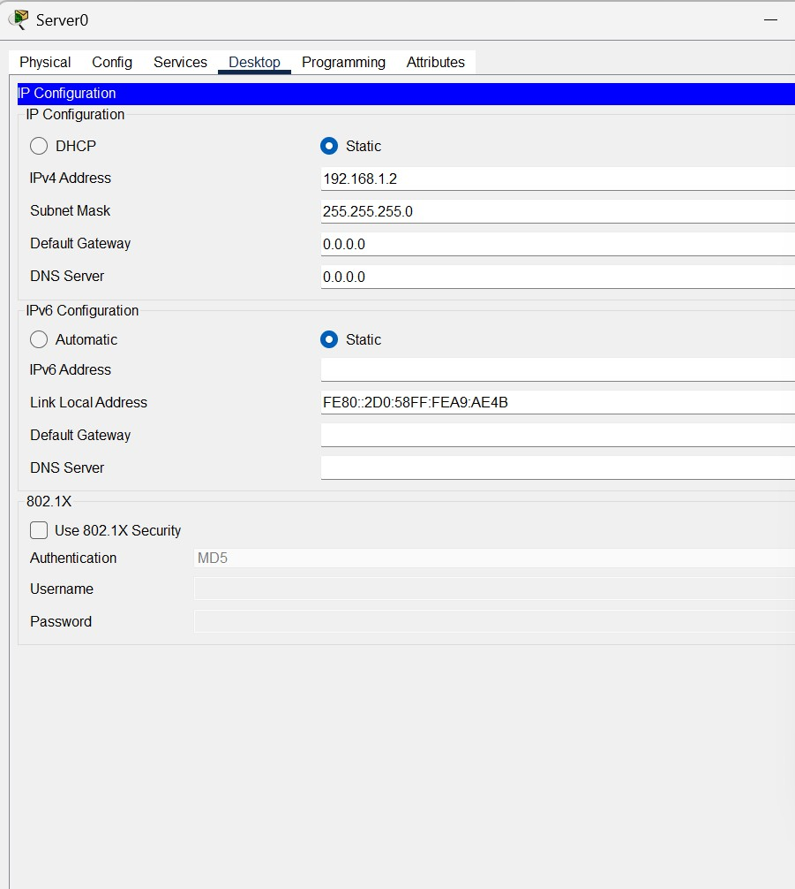
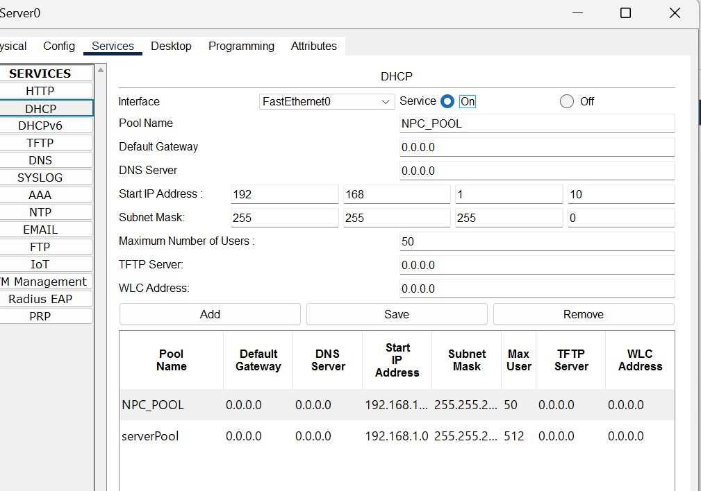
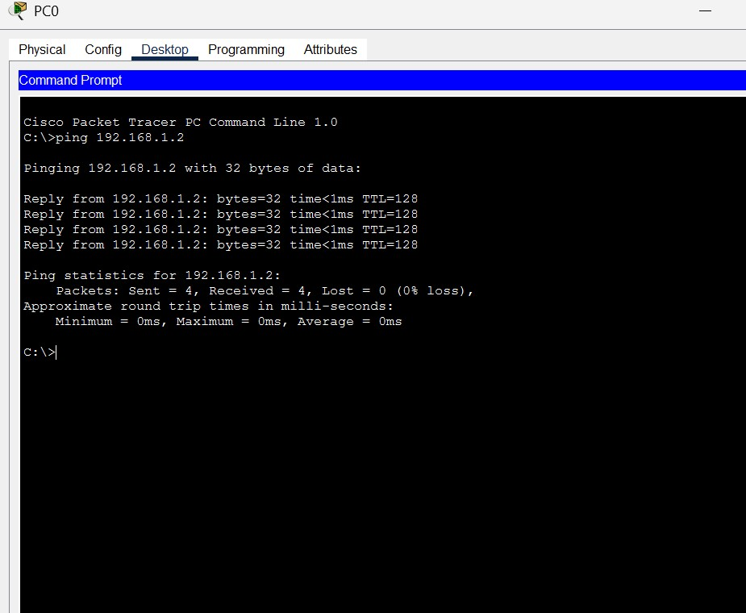
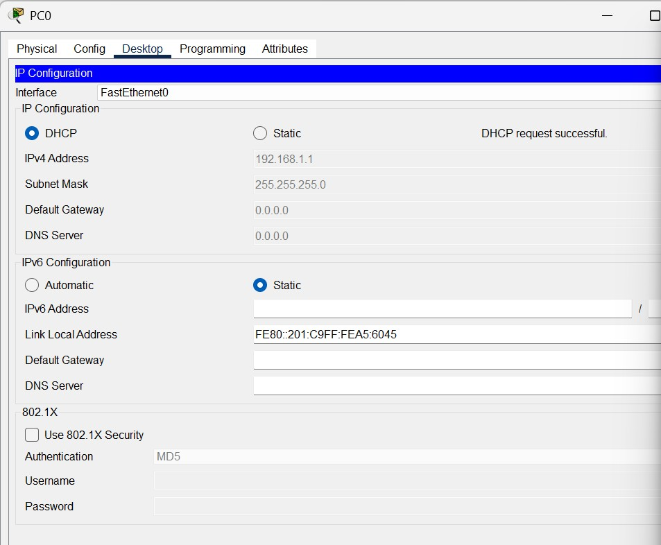
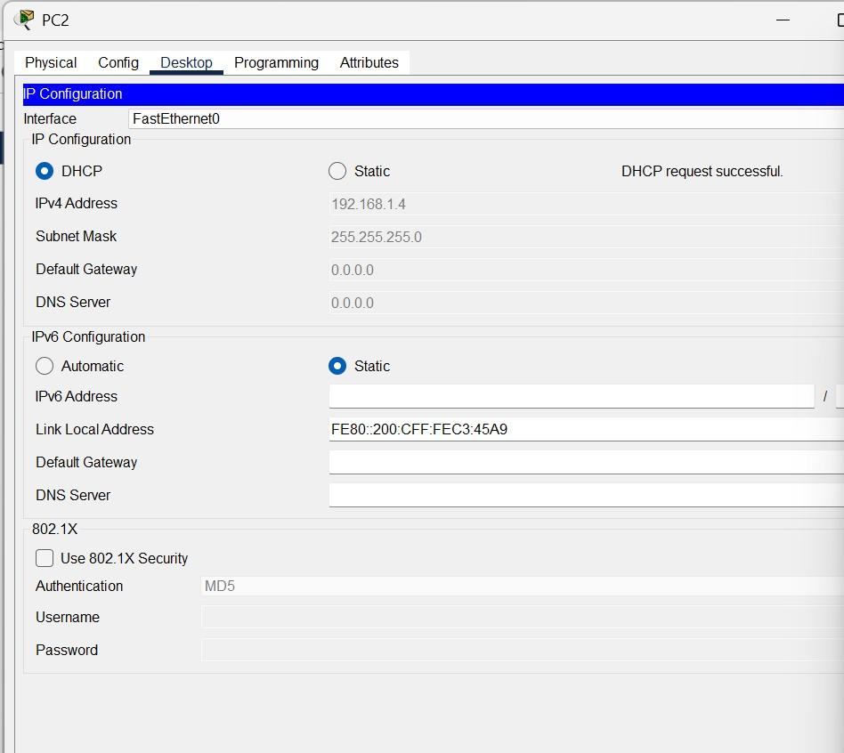
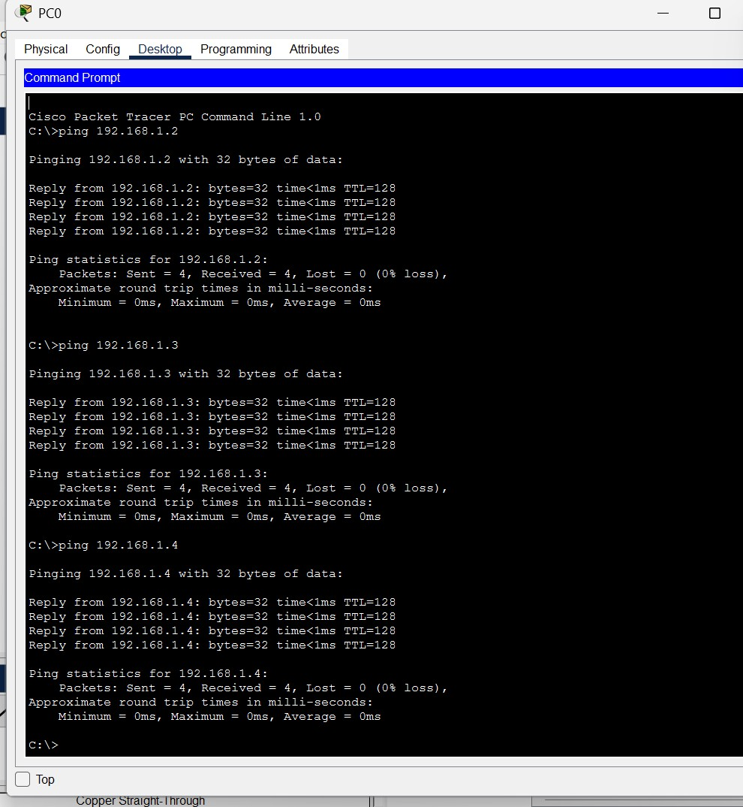

# NPC – Unit 4: Configure DHCP and Set Up a Network Using Cisco Packet Tracer

Practical assignment for the **Networking Protocols and Communication (NPC)** course.

| Field | Details |
|---|---|
| **Author** | Yash Kawade |
| **PRN** | 2125UCSM1118 |
| **Department** | Cyber Security |
| **Semester** | 3rd Semester (Second Year) |
| **Subject** | Network Protocols and Communication (NPC – Unit 4) |
| **Software** | Cisco Packet Tracer 9.0.1 |
| **Assignment Unit** | Unit 4 – DHCP Configuration |

---

## 1. Aim
To create a small Local Area Network (LAN) in Cisco Packet Tracer, configure a server with a static IPv4 address, enable the Dynamic Host Configuration Protocol (DHCP) service, assign IP configurations automatically to client PCs, and verify end-to-end network connectivity using the ICMP `ping` command.

---

## 2. Network Topology

The network topology consists of:
- **3 × Client PCs:** `PC0`, `PC1`, `PC2` (End devices)
- **1 × Switch:** Cisco 2960-24TT (`Switch0`) (Central Layer-2 switch)
- **1 × Server:** Server-PT (`Server0`) (DHCP Server)
- **Cabling:** Copper Straight-Through Ethernet cables connecting all devices to `Switch0`.


*Figure 1: Network topology with PC0, PC1, PC2, Server0, and Switch0 in Cisco Packet Tracer.*

---

## 3. IP Addressing and DHCP Configuration

`Server0` is configured with a static IPv4 address to provide reliable and persistent network services to the clients. The DHCP service is activated on `FastEthernet0` with a dedicated pool named `NPC_POOL`.

### DHCP Pool & Server Parameters
| Device / Setting | Configured Value |
|---|---|
| **Server0 IPv4 Address** | `192.168.1.2` |
| **Server0 Subnet Mask** | `255.255.255.0` |
| **DHCP Service** | On |
| **DHCP Pool Name** | `NPC_POOL` |
| **Start IP Address** | `192.168.1.10` |
| **Subnet Mask** | `255.255.255.0` |
| **Maximum Number of Users** | 50 |
| **Default Gateway / DNS** | `0.0.0.0` (not required for local LAN test) |

### Server0 Static IP Configuration

*Figure 2: Server0 static IPv4 address configuration.*

### DHCP Service Setup
Navigate to **Server0** → **Services** → **DHCP**, turn the service **On**, and create/save the `NPC_POOL` entry:

*Figure 3: DHCP service and NPC_POOL settings.*

---

## 4. Automatic IP Configuration on Client PCs

On each client PC, open **Desktop** → **IP Configuration** and select **DHCP**. Each device successfully sends a DHCP Discover message and is leased an IPv4 configuration:

| PC | Interface | Assigned IP Address | Subnet Mask | DHCP Status |
|---|---|---|---|---|
| **PC0** | FastEthernet0 | `192.168.1.1` | `255.255.255.0` | DHCP request successful |
| **PC1** | FastEthernet0 | `192.168.1.3` | `255.255.255.0` | DHCP request successful |
| **PC2** | FastEthernet0 | `192.168.1.4` | `255.255.255.0` | DHCP request successful |

### Client Screenshots

*Figure 4: PC0 IP configuration (DHCP successful).*


*Figure 5: PC1 IP configuration (DHCP successful).*


*Figure 6: PC2 IP configuration (DHCP successful).*

---

## 5. Connectivity Testing (Ping Verification)

Network connectivity was verified from **PC0** using the Command Prompt by pinging the DHCP server and peer workstations:
```shell
C:\> ping 192.168.1.2    # Server0
C:\> ping 192.168.1.3    # PC1
C:\> ping 192.168.1.4    # PC2
```

**Results:**
- All tests returned **4 replies out of 4 packets sent** (`0% packet loss`).
- Round-trip time: `<1ms`, `TTL = 128`.


*Figure 7: Successful ping tests from PC0 to Server0, PC1, and PC2.*

---

## 6. Repository Files

| File | Description |
|---|---|
| [`NPC_Unit4_DHCP_Assignment_Report_Yash_Kawade.pdf`](NPC_Unit4_DHCP_Assignment_Report_Yash_Kawade.pdf) | Submission-ready practical report in PDF |
| [`NPC_Unit4_DHCP_Assignment_Report_Yash_Kawade.docx`](NPC_Unit4_DHCP_Assignment_Report_Yash_Kawade.docx) | Word document report file |
| [`NPC_Unit4_DHCP_Assignment.pkt`](NPC_Unit4_DHCP_Assignment.pkt) | Cisco Packet Tracer 9.0 simulation file |
| [`screenshots/`](screenshots/) | Captured Packet Tracer screenshots |

---

## 7. Results and Conclusion
The LAN topology was successfully designed, configured, and verified in Cisco Packet Tracer:
- `Server0` was configured with a static IP and the DHCP service was enabled.
- All client PCs (`PC0`, `PC1`, `PC2`) obtained IPv4 configurations automatically via DHCP without manual IP assignment errors.
- End-to-end communication across all nodes was verified via ICMP ping tests with 100% success rate, demonstrating the operation of dynamic host configuration within a local network.
